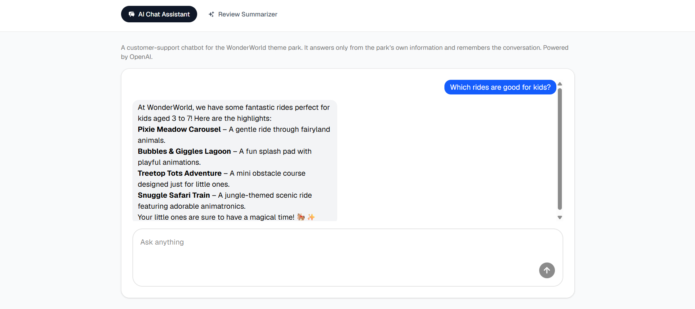
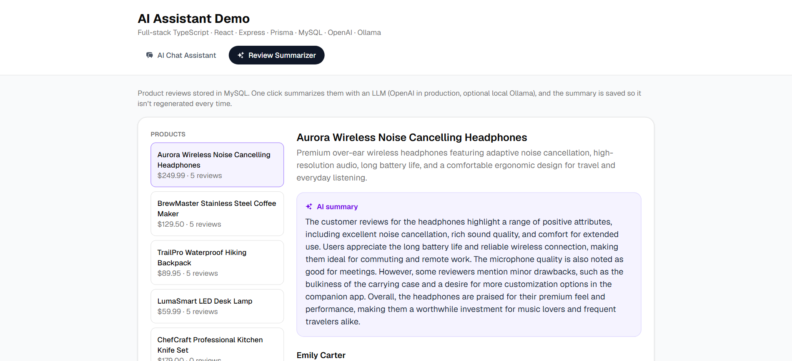
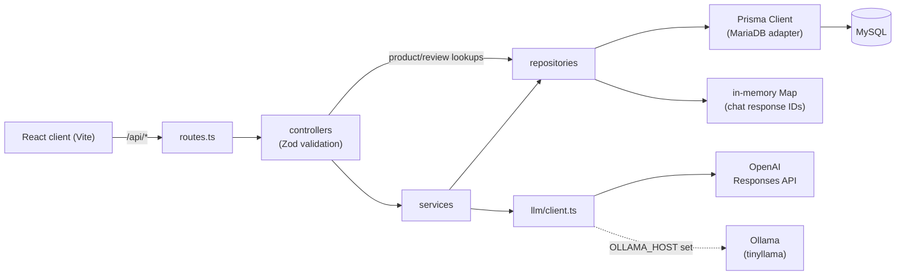

# AI Assistant Demo

A full-stack TypeScript app with two production-style LLM features: a **customer-support chatbot with conversation memory** and an **AI product-review summarizer with database caching**.

[](https://www.typescriptlang.org/)
[](https://react.dev/)
[](https://bun.com/)
[](https://ai-assistant-demo-nine.vercel.app/)

**Live demo:** [ai-assistant-demo-nine.vercel.app](https://ai-assistant-demo-nine.vercel.app/)

| AI Chat Assistant                                | Review Summarizer                                                |
| ------------------------------------------------ | ---------------------------------------------------------------- |
|  |  |

## Features

### AI Chat Assistant

A support bot for **WonderWorld**, a fictional theme park.

- Uses the **OpenAI Responses API** (`gpt-4o-mini`, temperature 0.2).
- **Conversation memory:** each response's ID is stored per conversation and sent back as `previous_response_id`, so OpenAI keeps the context server-side and the client only sends the new message.
- **Prompt templates:** the system instructions come from `llm/prompts/chatbot.txt`, with the park's information (`WonderWorld.md`) filled into the `{{parkInfo}}` placeholder. The bot only answers questions about the park.
- **Input validation:** Zod checks the request (prompt is 1–1000 characters after trimming; `conversationId` must be a UUID).
- **UI:** suggested questions, a typing indicator, Markdown rendering of replies, and sound effects.

### Review Summarizer

- Products and reviews live in **MySQL**, accessed through **Prisma 7**.
- **One-click summaries** of a product's 10 most recent reviews.
- **Switching between a local and a cloud model:** uses **Ollama** (`tinyllama`) when `OLLAMA_HOST` is set, otherwise OpenAI `gpt-4o-mini`, so it runs locally and on Vercel with no code changes.
- **Summary cache in the database:** summaries are saved in a `summaries` table with a **7-day expiry**. Expired summaries are ignored and regenerated on request.
- **Seed script you can run repeatedly:** products are upserted by ID, and reviews are only inserted for products that have none, so rerunning it never creates duplicates.
- **UI:** product list with review counts, star ratings, and loading skeletons (TanStack Query).

## Tech stack

| Area           | Technologies                                                                                       |
| -------------- | -------------------------------------------------------------------------------------------------- |
| **Client**     | React 19, Vite, Tailwind CSS v4, shadcn/ui, TanStack Query, axios, react-hook-form, react-markdown |
| **Server**     | Express 5, Zod, Prisma 7 with the MariaDB driver adapter, OpenAI SDK, Ollama SDK, dayjs            |
| **Database**   | MySQL (hosted on Aiven, with TLS)                                                                  |
| **Tooling**    | Bun (runtime, package manager, workspaces), TypeScript, Prettier, Husky + lint-staged, ESLint      |
| **Deployment** | Vercel: the Vite client as a static site, the Express app as a serverless function                 |

## Architecture



```
.
├── packages/
│   ├── client/                 # React + Vite single-page app
│   │   ├── public/             # favicon, social preview image
│   │   └── src/components/
│   │       ├── chat/           # ChatBot, ChatInput, ChatMessages, TypingIndicator
│   │       ├── reviews/        # ProductReviews, ReviewList, StarRating, reviewsApi
│   │       └── ui/             # shadcn/ui components
│   └── server/                 # Express API
│       ├── controllers/        # HTTP layer: parse, validate, respond
│       ├── services/           # business logic (chat, summaries + cache)
│       ├── repositories/       # data access (Prisma, conversation store)
│       ├── llm/                # OpenAI/Ollama client + prompt files
│       ├── prisma/             # schema, migrations, seed, CA certificate
│       ├── prisma.ts           # Prisma client + MariaDB SSL setup
│       ├── routes.ts
│       └── index.ts            # app entry (listens locally, exported for Vercel)
├── vercel.json                 # client + server services and /api rewrites
└── package.json                # workspaces + root dev script
```

## API reference

| Method | Path                                  | Params / body                              | Response                                                                                             |
| ------ | ------------------------------------- | ------------------------------------------ | ---------------------------------------------------------------------------------------------------- |
| `POST` | `/api/chat`                           | `{ prompt: string, conversationId: uuid }` | `{ message }` · `400` Zod error tree · `500 { error }`                                               |
| `GET`  | `/api/products`                       | —                                          | `[{ id, name, description, price, reviewCount }]`                                                    |
| `GET`  | `/api/products/:id/reviews`           | `id`: product ID                           | `{ summary: string \| null, reviews: Review[] }` (newest first) · `400` invalid ID · `404` not found |
| `POST` | `/api/products/:id/reviews/summarize` | `id`: product ID                           | `{ summary }` · `400` invalid ID or no reviews · `404` not found                                     |
| `GET`  | `/api/hello`                          | —                                          | `{ message: "Hello world!" }` (health check)                                                         |

`summary` in `GET /reviews` is the cached summary if it hasn't expired, otherwise `null`. `POST /summarize` returns the cached summary if there is one, and otherwise generates and stores a new one.

## Engineering notes

- **Prisma `sslcert` → MariaDB driver TLS options.** The MariaDB driver ignores Prisma's `sslcert` / `sslaccept` URL parameters. `prisma.ts` converts them into driver `ssl` options instead: it loads the CA file, sets `rejectUnauthorized`, and sets `servername` to the database host (otherwise the certificate is checked against `localhost`). `prisma.config.ts` resolves a relative `sslcert` from `prisma/`, so the same `DATABASE_URL` works for both the app and the Prisma CLI.
- **Workaround for Bun's empty `getPeerCertificate()`.** After the handshake the driver checks the hostname again using `getPeerCertificate()`, which returns an empty object under Bun, so that check always failed. A custom `checkServerIdentity` skips the second check only when there's no certificate data; the TLS handshake has already verified the CA and hostname.
- **Prompt files that work on both Bun and Node.** Prompts are read with `fs.readFileSync(new URL('./prompts/…', import.meta.url))`. That resolves relative to the module rather than the working directory, so it works with Bun locally and Node on Vercel.
- **Vercel serverless setup.** `vercel.json` defines two services: the Vite client, and the Express server, which builds with `prisma generate`. `/api/*` requests are routed to the server and everything else to the client. Files that are only read at runtime aren't detected automatically, so `includeFiles` bundles `prisma/ca.pem` and `llm/prompts/**` into the function. `index.ts` exports the app and only calls `listen()` when `VERCEL` isn't set.

## Getting started

**Prerequisites:** [Bun](https://bun.com/) 1.3+, a MySQL database, an OpenAI API key, and optionally [Ollama](https://ollama.com/) with `ollama pull tinyllama`.

```bash
# 1. Install dependencies (all workspaces)
bun install

# 2. Configure the server environment
cp packages/server/.env.example packages/server/.env
#    then fill in OPENAI_API_KEY and DATABASE_URL (and OLLAMA_HOST if you use Ollama)

# 3. Set up the database
cd packages/server
bunx prisma migrate deploy   # apply migrations
bunx prisma generate         # generate the Prisma client
bunx prisma db seed          # load sample products and reviews
cd ../..

# 4. Run client and server together
bun run dev
```

The client runs at http://localhost:5173 and sends `/api` requests to the server at http://localhost:3000.

## Known limitations & roadmap

- **Chat memory is kept in memory.** Response IDs are stored in an in-process `Map`, so they're lost on restart and aren't shared between serverless instances. Next step: store them in a database table.
- **No rate limiting or authentication** on the endpoints that call paid LLMs yet.
- **No automated tests yet.** Service-level tests with a mocked LLM client are planned.
- **Summary quality with `tinyllama`** is limited. It's a very small local model, and OpenAI produces noticeably better summaries.

## Author

**Moudar Afifeh** · [LinkedIn](https://www.linkedin.com/in/afifehmoudar/) · [GitHub](https://github.com/MoudarAfifeh)
